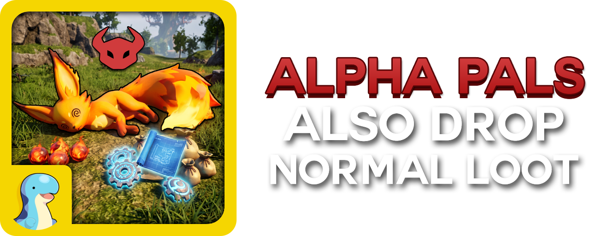

<p align="center">
  
</p>

<p align="center">
  This is a simple mod that enables and adds the loot drops from Non-Alpha pals into their Alpha counterparts.
</p>

<p align="center">
  By default, the Item drops from Alpha Pals are different, you usually get Ancient Civilisation Parts and an item whose only use is to be sold. I simply added the drops from non-alphas into the alphas so you get both. Making butchering Alphas late game actually worthwhile.
</p>

<p align="center">
  I use this mod regularly, so I'll try to keep it updated as much as possible. If you come across any issues or bugs, please let me know so I can try to fix them.
</p>

<p align="center">
  Made with love for the community! Thank you to everyone who was
  welcoming and kind ♥️
</p>

## Requirements

- **PalSchema** 0.6.0 or newer.
- **UE4SS Experimental (Palworld)** — the Palworld-specific build.

Do **not** also install UE4SS by hand if the Steam Workshop version is present.

## Install

Subscribe on Steam Workshop, then enable it in-game under
**Options → Mod Management**.

## What it contains

| File | Rows | Covers |
|------|------|--------|
| `AlphaLootMerge.jsonc` | 319 | Ordinary Alpha Pals |
| `EndgameAlphaLoot.jsonc` | 31 | World Tree bosses and the MimicDog ladder |
| **Total** | **350** | |

Across both files, **669 loot entries** are switched on:

- **579 are a drop chance changed on a slot the game had already filled and switched off.**
  These rows change one number each, because Palworld had already put the right
  item in the right slot for the normal Pal's loot and just set the chance to 0.
- **90 are items added into empty slots,** for the Alphas whose row ran out of room
  before the game copied every item across.

Rates are copied from the normal Pal, not raised. A 10% drop stays 10%, so an Alpha
is never a strictly better source than its wild version.

## Compatibility

Slot 10 is never written. It belongs to
[Pals Drop Dog Coins](https://steamcommunity.com/sharedfiles/filedetails/?id=3816899969), [Source Code](https://codeberg.org/DeSynkro/pals-drop-dog-coins),
so the two mods run together with no conflict.

This mod writes to slots 2 to 9. Those are used because most of them were empty or
switched off, but a different mod editing the same Pal's drop table can still clash.

**Any other mod that modifies the same slots for a Pal's Item Drops will likely
cause issues, please be aware.**

**One Pal is incomplete.** Neptilius has a single free slot but needs two items, so
it gets its Diamond and Pal Upgrade Stone back but not Stainless Steel. It would
take a slot the game uses to fit that last one, and nothing was ever going to drop
from it anyway, so it was left out rather than overwritten.

## Editing the mod

Every row is commented with the Pal's display name, and each change has a note
above it saying what it does. The lines marked `vanilla` are comments only, they
show what the Alpha already dropped so you can see what the mod is adding.

```
        // Shadowbeak
        "BOSS_BlackGriffon000": {
            // vanilla: PalCrystal_Ex  100%  x6-8  (slot 1)
            // vanilla: PalItem_ToSell_02  100%  x6-8  (slot 4)
            // Plastic: 0% -> 100%   (already in slot 2, rate only)
            "Rate2": 100,
```

To regenerate the files rather than hand-edit them, run `tools/build_merge.py`. It
rebuilds both files from the game's own drop table and refuses to write if any
slot collides or a live drop would be overwritten.

## Butchering

Butchering uses the same drop table as killing or capturing, so a captured Alpha
gives you a second roll at everything listed above.
